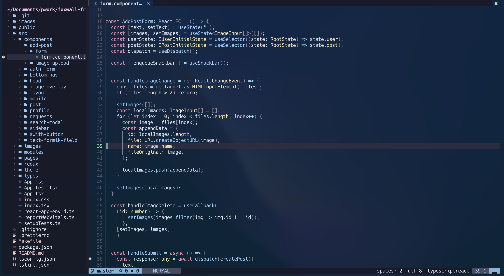
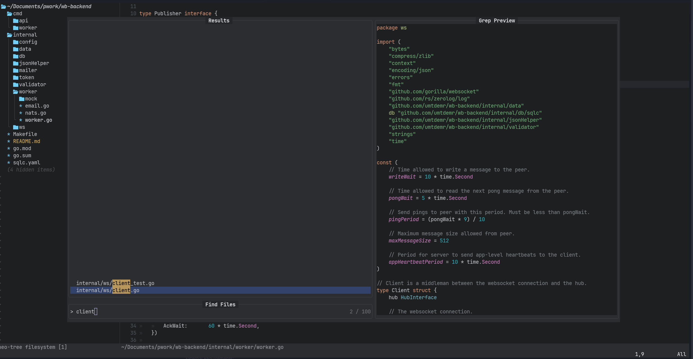

# Neovim

This is the neovim configuration I use. I gave up on configuring neovim myself. Instead, I've started to use [kickstart.nvim](https://github.com/nvim-lua/kickstart.nvim).

It started as kickstart and slowly became mine. It now uses Neovim's built-in plugin manager (`vim.pack`) instead of lazy.nvim, and the big single `init.lua` is split into small files so I can actually find things.

## Requirements

* Neovim 0.12+ (`vim.pack` doesn't exist before that)
* `git`, `make`, a C compiler, [ripgrep](https://github.com/BurntSushi/ripgrep)
* [tree-sitter CLI](https://github.com/tree-sitter/tree-sitter) to build the parsers
* [lazygit](https://github.com/jesseduffield/lazygit) for `<leader>gg`
* A Nerd Font. Ghostty and WezTerm already ship the icons, so plain JetBrains Mono works for me.

Language servers, formatters and linters (gopls, ts_ls, prettierd, golangci-lint...) are installed by Mason on the first start.

## Structure

```
init.lua            loads everything below, in order
lua/config/         options, keymaps, autocmds, vim.pack build hooks
lua/plugins/        one file per area: ui, git, telescope, lsp, format, completion, treesitter
lua/kickstart/      optional kickstart plugins I turned on: neo-tree, autopairs, indent lines, lint
```

## What I added on top of kickstart

* Go: gopls, goimports on save, golangci-lint
* TypeScript / CSS: ts_ls, cssls, ESLint (only when the project has an ESLint config), prettierd on save
* Git: gitsigns, [diffview](https://github.com/sindrets/diffview.nvim) (`<leader>gd`), [lazygit](https://github.com/kdheepak/lazygit.nvim) (`<leader>gg`), git status/branches in Telescope (`<leader>gs`, `<leader>gb`)
* Buffers reload by themselves when a file changes on disk. Handy when an AI agent is editing files next to me.
* `<leader>e` toggles neo-tree, `super-tab` for completion
* [jb.nvim](https://github.com/nickkadutskyi/jb.nvim) colorscheme

## Screenshots



