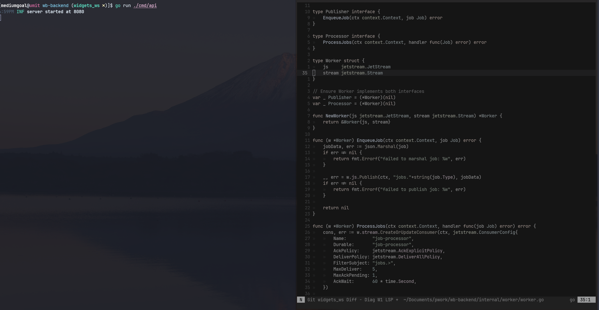
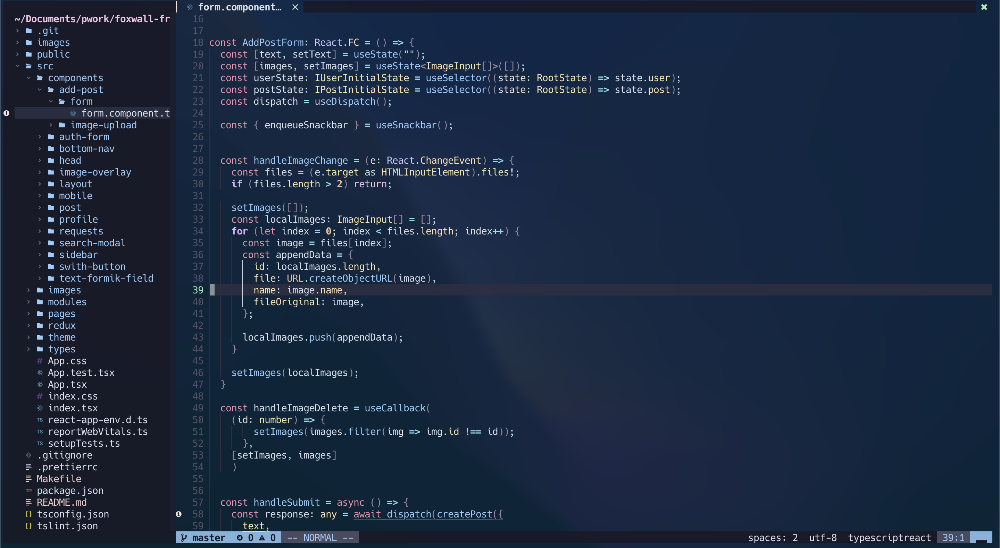

# umtdemr's Dotfiles

This is umtdemr's terminal setup.

## Content

This setup includes:

* Zsh
* Neovim
* Ghostty
* tmux
* lazygit

## Terminal

These days I'm on [Ghostty](https://ghostty.org) with [tmux](https://github.com/tmux/tmux) on top of it. Ghostty opens straight into a tmux session called `main`, and tmux takes care of the splits, tabs and the status bar.

Before that I was using [WezTerm](https://wezfurlong.org/wezterm/index.html "Wez's Terminal Emulator") (and before that, [alacritty](https://github.com/alacritty/alacritty "Alacrity's github page") and [iTerm2](https://iterm2.com/index.html)). I wrote [a blog post](https://umitde.com/blog/i-switched-to-wezterm) about why I moved to WezTerm back then. When I switched, I ported my WezTerm setup to Ghostty + tmux, so the keybindings feel the same: `ctrl+a` is the leader.

* Terminal: Ghostty
* Multiplexer: tmux
* Theme: [Poimandres](https://github.com/drcmda/poimandres-theme)
* Font: JetBrains Mono
* Shell: ZSH

My old WezTerm config is still in `.config/wezterm` in case I go back.

## Neovim



I'm using [kickstart.nvim](https://github.com/nvim-lua/kickstart.nvim) with Neovim's built-in plugin manager (`vim.pack`). For more information about the neovim configuration I use, please check out [neovim folder](https://github.com/umtdemr/Dotfiles/tree/master/.config/nvim)

## ZSH

* Theme: gianu
* Additional plugins: zsh-autosuggestions, zsh-syntax-highlighting

## Setup

```sh
ln -s ~/dotfiles/.config/nvim ~/.config/nvim
ln -s ~/dotfiles/.config/tmux ~/.config/tmux
ln -s ~/dotfiles/.config/lazygit ~/.config/lazygit
mkdir -p ~/.config/ghostty/themes
ln -s ~/dotfiles/.config/ghostty/config ~/.config/ghostty/config
ln -s ~/dotfiles/.config/ghostty/themes/poimandres ~/.config/ghostty/themes/poimandres
```
